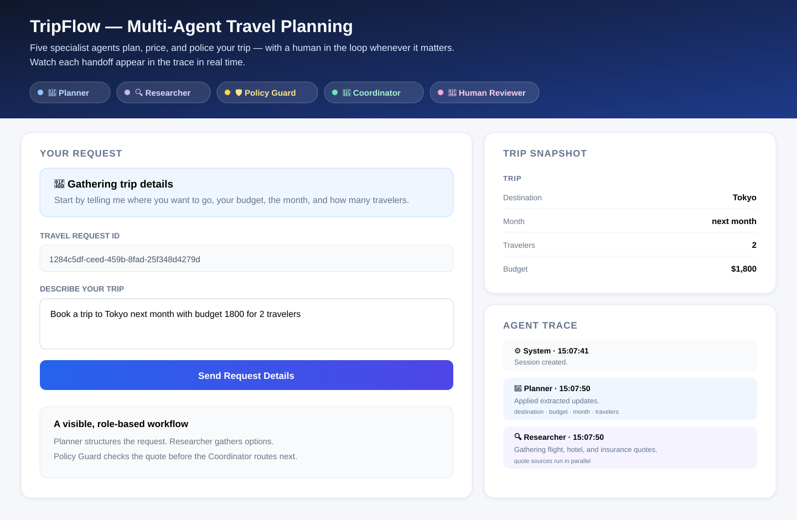
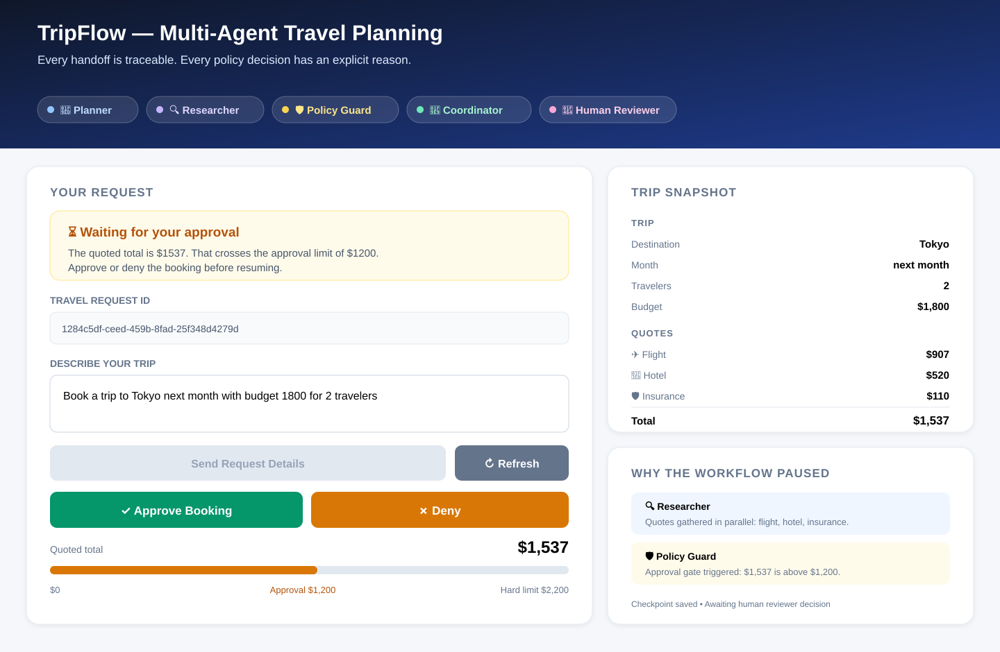
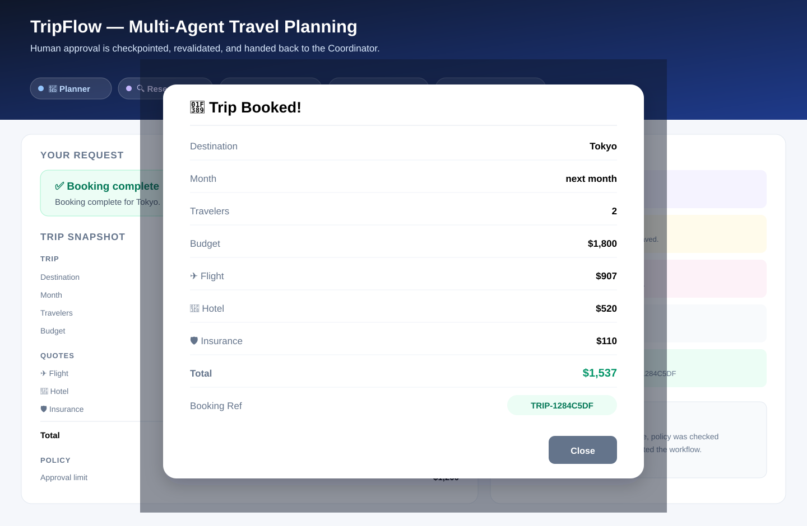

# TripFlow

**A transparent multi-agent travel planning workflow with policy checks, human review, and recoverable checkpoints.**

TripFlow demonstrates how specialized agents can collaborate through explicit handoffs and coordinator-led routing. It makes each stage visible in the web interface, including the reasons a request completes, pauses for approval, or is blocked.

> **Prototype notice:** quotes are deterministic simulations. TripFlow does not query travel providers or make real bookings. Sessions are held in process memory, so this single-process demo is not suitable for public production deployment.

## What it demonstrates

- **Planner** extracts destination, budget, month, and traveler count from a message.
- **Researcher** produces simulated flight, hotel, and insurance quotes.
- **Policy Guard** applies configurable approval and hard-stop limits.
- **Coordinator** routes each workflow through explicit state transitions.
- **Human Reviewer** can approve or deny requests that need review.
- **Trace and checkpoints** make agent handoffs visible and allow paused workflows to resume.

The default policy asks for approval at **$1,200** and blocks totals of **$2,200 or more**. Requests below the approval limit can complete automatically.

## How the workflow runs

1. Create a session and send a travel request.
2. The Planner extracts structured request details.
3. The Researcher gathers simulated quotes in parallel.
4. The Policy Guard determines whether the workflow completes, waits for approval, or stops.
5. If approval is required, TripFlow saves a checkpoint and waits for a human decision.
6. On approval, the Coordinator resumes from the checkpoint and revalidates policy.

Agent activity and routing decisions appear in the Trace panel.

## App preview







## Run locally

Requirements: Python 3.12 or newer and [uv](https://docs.astral.sh/uv/).

```bash
uv sync --extra dev
uv run uvicorn main:app --reload --port 8015
```

Open [http://localhost:8015](http://localhost:8015). Try:

```text
Book a trip to Tokyo next month with budget 1800 for 2 travelers
```

The request should wait for approval with the default policy. The app also exposes interactive API documentation at [http://localhost:8015/docs](http://localhost:8015/docs).

## Run tests

```bash
uv run pytest -q
```

Tests use isolated temporary checkpoint storage and do not modify local runtime data.

## Run with Docker Compose

```bash
docker compose up --build
```

Open [http://localhost:8015](http://localhost:8015). Compose persists checkpoint files in a named volume and checks the `/health` endpoint.

## Project layout

| File | Purpose |
| --- | --- |
| `main.py` | ASGI application entry point |
| `webapp.py` | FastAPI routes, session management, and trace streaming |
| `orchestration.py` | Agent workflow, policy routing, and state transitions |
| `app_models.py` | Request, policy, trace, and session models |
| `checkpoint_store.py` | JSON checkpoint persistence |
| `static/index.html` | Browser interface |
| `tests/test_workflow.py` | Workflow and API tests |

## API overview

- `GET /health` — liveness check
- `POST /api/session` — create a workflow session
- `POST /api/chat` — submit request details
- `POST /api/approval` — approve or deny a paused request
- `POST /api/resume` — resume a saved workflow

The streaming chat and approval endpoints are available at `/api/chat/stream` and `/api/approval/stream`.

## GitHub and operations

GitHub Actions runs the test suite on pushes and pull requests. Dependabot is configured to check for Python and GitHub Actions updates. `.gitignore` excludes local environments, runtime checkpoints, and generated files.

Before deploying beyond a local demo, replace simulated quotes and booking with trusted service integrations, add authentication and authorization, and move session/checkpoint storage to a durable shared service. Run a single application worker with the current in-memory session implementation.

No license is included yet; choose one before publishing this repository publicly.
